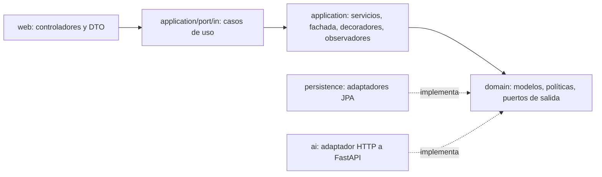

# CampusNexo Backend

API REST del campus universitario inteligente, proyecto del curso Patrones de Software, modelada sobre la Universidad Cooperativa de Colombia, campus Pasto (bloques A y B, 107 espacios tomados del plano 2025-B). Está hecha con Java 21, Spring Boot 4.1 y PostgreSQL. Recibe mediciones agregadas de los espacios, estima la ocupación con el servicio de IA (con respaldo local si la IA falla), genera recomendaciones auditables de climatización, ventilación e iluminación según el clima del campus, detecta alertas, gestiona reservas y muestra en vivo los puestos libres de la biblioteca.

## Qué problema del caso resuelve cada parte

| Problema del caso | Funcionalidad |
|---|---|
| Salones reservados pero vacíos o sobreocupados | Reservas con control de aforo y de solapamiento; alertas `RESERVA_SIN_USO` y `SOBRECUPO`. |
| Consumo de energía en espacios vacíos | Alerta `CONSUMO_ESPACIO_VACIO`, recomendaciones de HVAC e iluminación por sede y estimación en kWh y COP en el dashboard. |
| Biblioteca saturada sin información de puestos libres | `GET /api/v1/occupancy/live?type=BIBLIOTECA`: puestos libres, % de ocupación y estado `LIBRE`, `MODERADO` o `SATURADO`. |

## Gemelo digital en tiempo real

La cámara edge (YOLO + ByteTrack) y el Arduino de cada salón (DHT22, fotorresistencia, sensor de corriente y relés) publican por MQTT. Un filtro de Kalman fusiona la cámara, el CO₂ y el Wi-Fi; cada puesto de la biblioteca se evalúa por ray casting con un cronómetro anti-acaparamiento; y un controlador predictivo de inercia térmica elige la estrategia del aire acondicionado y la envía al ESP32. Si un salón queda vacío 5 minutos con luces o equipos encendidos, el Arduino recibe la orden de apagarlos. El dashboard recibe cada cambio y la traza por la arquitectura vía WebSocket/STOMP. Los detalles, los contratos MQTT y los 13 escenarios de sustentación están en [`docs/gemelo-digital.md`](docs/gemelo-digital.md).

## Arquitectura

El núcleo (`domain` y `application`) **no depende de Spring, JPA ni HTTP**; se puede compilar con `javac` sin dependencias. Los adaptadores de `infrastructure` implementan los puertos y `ApplicationConfiguration` es la raíz de composición.



```text
edu.campusnexo
├── domain/                     reglas puras, sin frameworks
│   ├── shared/                 DomainValidationException, DomainChecks, ResultLimit
│   ├── catalog/ telemetry/ occupancy/ alert/ reservation/
│   ├── climate/                decisiones, contexto, recomendación (Builder)
│   │   └── policy/             Abstract Factory + Strategy + Decorator térmico
│   ├── vision/                 StudyZoneRoi (ray casting), detecciones, estado de puestos
│   ├── twin/                   Kalman, MPC térmico, estados del gemelo, ahorro
│   ├── trace/                  traza de la arquitectura hexagonal
│   └── port/                   puertos de salida (repositorios, IA, actuador HVAC, notificador)
├── application/                casos de uso, uno por subpaquete
│   ├── port/in/                contratos de entrada, comandos y resultados
│   ├── exception/              errores de aplicación con código estable
│   ├── catalog/ telemetry/ occupancy/ climate/ alert/ reservation/ dashboard/
│   ├── operations/             CampusOperationsFacade (Facade)
│   ├── twin/                   ProcessSpaceTelemetryService, controles, consultas, trazas
│   └── simulation/             escenarios de sustentación sobre el mismo caso de uso
└── infrastructure/
    ├── config/                 ApplicationConfiguration, HexagonalBeanConfiguration, MQTT, WebSocket
    └── adapter/
        ├── in/web/             controladores REST (TwinController, TwinIngestionController, SimulationController…), errores, cursores
        ├── in/mqtt/            YoloMqttTelemetryInboundAdapter, ArduinoMqttEnvironmentInboundAdapter
        ├── contract/           JSON compartido por REST, STOMP y MQTT
        ├── out/persistence/    adaptadores JPA (incluye PostgresSpaceRepositoryAdapter)
        ├── out/ai/             HttpOccupancyEstimatorAdapter (Adapter)
        ├── out/mqtt/           Esp32HvacActuatorAdapter, ArduinoEquipmentCommandAdapter
        ├── out/websocket/      StompTwinChangeNotifierAdapter
        └── out/observability/  logs y actuador sin hardware
```

Los patrones, sus participantes y el guion de demostración están en [`docs/patrones-de-software.md`](docs/patrones-de-software.md).

Las decisiones transversales de arquitectura, seguridad y operación están registradas en [`docs/adr/`](docs/adr/README.md).

## Inicio local con Docker Compose

```sh
cp .env.example .env      # define contraseñas locales
docker compose up --build -d
curl http://localhost:8080/actuator/health
curl http://localhost:8080/api/v1/spaces
```

Si el servicio de IA no está levantado, la estimación de ocupación responde igual, con `source = RESPALDO_LOCAL` (se puede desactivar con `AI_FALLBACK_ENABLED=false`, y entonces responde `503`).

## Ejecución y pruebas con Maven

Requisitos: Java 21, Maven 3.9+ y Docker (para las pruebas de integración con Testcontainers).

```sh
mvn verify                # pruebas unitarias + integración con PostgreSQL 17 + cobertura JaCoCo
mvn spring-boot:run       # requiere un PostgreSQL local (ver DATABASE_URL)
```

El reporte de cobertura queda en `target/site/jacoco/index.html`, y la CI lo publica como artefacto `test-reports`.

| Suite | Qué demuestra |
|---|---|
| `domain/**` | Familias del Abstract Factory, estrategias, decorador de ciclo mínimo, Builder, validaciones. |
| `application/**` | Idempotencia y validación de la ingesta, Observer con fallos aislados, decoradores de IA, fachada de punta a punta, reservas, ocupación en vivo, energía. |
| `HexagonalArchitectureTest` | ArchUnit: el dominio y la aplicación no dependen de Spring, JPA, Jackson ni Paho. |
| `CampusNexoApiIntegrationTest` | Arranque real con Flyway V1–V13 y validación JPA, seguridad por rol (401/403, STOMP), reservas concurrentes sin solapamiento, paginación por cursor, alertas, evaluación con la IA caída, rutas antiguas, `ProblemDetail`. |

## API v1 (resumen)

Todas las rutas, salvo `/actuator/health`, `/api/v1/auth/login` y `/api/v1/auth/session`, exigen inicio de sesión (`Authorization: Bearer <token>`) o una clave de sensor (`X-API-Key`). Rol mínimo: 👁 VIEWER, 🛠 OPERATOR, 🔐 ADMIN, 📡 SENSOR.

| Método y ruta | Rol | Propósito |
|---|---|---|
| `POST /api/v1/auth/login`, `GET /api/v1/auth/session` | público | Iniciar sesión (token firmado con rol) y consultar la sesión. |
| `GET /api/v1/spaces[?type=]`, `GET /api/v1/spaces/{id}` | 👁 | Catálogo. |
| `POST /api/v1/telemetry` | 📡 | Registra una lectura (idempotente) y dispara los observadores. |
| `GET /api/v1/telemetry[?spaceId=&limit=&cursor=]`, `GET /api/v1/spaces/{id}/telemetry` | 👁 | Lecturas recientes, paginadas por cursor (`X-Next-Cursor`). |
| `POST /api/v1/spaces/{id}/evaluations` | 🛠 | **Flujo completo**: última lectura → IA → recomendación. |
| `POST /api/v1/spaces/{id}/occupancy-estimates`, `GET …` | 🛠 / 👁 | Estimación de ocupación persistida. |
| `GET /api/v1/occupancy/live[?type=BIBLIOTECA]` | 👁 | Ocupación y puestos libres en vivo. |
| `POST /api/v1/spaces/{id}/climate-recommendations`, `GET …` | 🛠 / 👁 | Recomendación manual e historial. |
| `GET /api/v1/alerts[?spaceId=&type=&limit=&cursor=]` | 👁 | Alertas, paginadas por cursor. |
| `POST /api/v1/spaces/{id}/reservations`, `DELETE /api/v1/reservations/{id}`, `GET …` | 🛠 / 👁 | Reservas; PostgreSQL impide solapamientos aun con peticiones simultáneas. |
| `GET /api/v1/dashboard/summary` | 👁 | Indicadores de las últimas 24 horas. |
| `GET /api/v1/twin/spaces`, `/twin/spaces/{id}`, `/twin/savings`, `/twin/traces` | 👁 | Gemelo digital, ahorro y trazas. |
| `POST /api/v1/twin/telemetry`, `POST /api/v1/twin/environment` | 📡 | Frame de cámara y lectura del Arduino por HTTP (mismo JSON que MQTT). |
| `POST /api/v1/twin/spaces/{id}/override\|popup\|maintenance` | 🛠 | Controles manuales del personal. |
| `GET /api/v1/simulation/scenarios`, `POST /api/v1/simulation/{escenario}` | 👁 / 🔐 | Escenarios de sustentación (apagados por defecto). |
| WebSocket STOMP `/ws` → `/topic/twin`, `/topic/traces` | 👁 | Actualizaciones en tiempo real (token en el `CONNECT`). |

El detalle está en [`docs/api.md`](docs/api.md) y la seguridad en [`SECURITY.md`](SECURITY.md).

## Configuración

Todas las variables están documentadas en [`.env.example`](.env.example) y [`application.yml`](src/main/resources/application.yml). En local, `.env.example` usa `SECURITY_MODE=development` (sin inicio de sesión, solo para un portátil); cualquier servidor debe usar `enforced` con `APP_USERS` (hashes de `tools/auth/hash_password.py`), `APP_SENSOR_KEYS` y `APP_TOKEN_SECRET`. El perfil `prod` (`SPRING_PROFILES_ACTIVE=prod`) elimina las credenciales por defecto y exige `INGEST_API_KEY`.

## Despliegue

`render.yaml` describe el sistema completo en Render (PostgreSQL, backend, servicio de IA y dashboard). Los pasos, las variables y los comandos para verificarlo están en [`docs/despliegue.md`](docs/despliegue.md).

## Límites del prototipo

- Los umbrales, setpoints y la heurística de respaldo son valores ilustrativos y no están calibrados. No se deben presentar como ahorro ni precisión medidos.
- El backend publica las órdenes de HVAC (ESP32) y de luces y equipos (Arduino) por MQTT; sin broker, solo las registra en el log. El sketch de `tools/arduino` no se ha probado con hardware real.
- Las personas se definen en configuración (`APP_USERS`), no con la identidad institucional; un token vale hasta que vence. El broker MQTT local es anónimo. Un uso institucional necesita SSO, TLS, autenticación del broker, retención de datos y evaluación de privacidad de la cámara (ver `SECURITY.md`).
- La IA de ocupación del servicio Python es una heurística (Kalman escalar con pesos fijos), no un modelo entrenado; YOLO es un modelo preentrenado que no se reentrenó. No hay mediciones de error todavía: el servicio trae la herramienta para medirlas.
- `V11` reemplaza el catálogo de demostración de `V2` y `V5` por el campus Pasto y `V12` carga los 107 espacios reales del plano. Los salones de clase tienen 36 pupitres (dato del campus, `V14`); el aforo y los computadores de los demás espacios son estimados a partir del tipo y del área.
