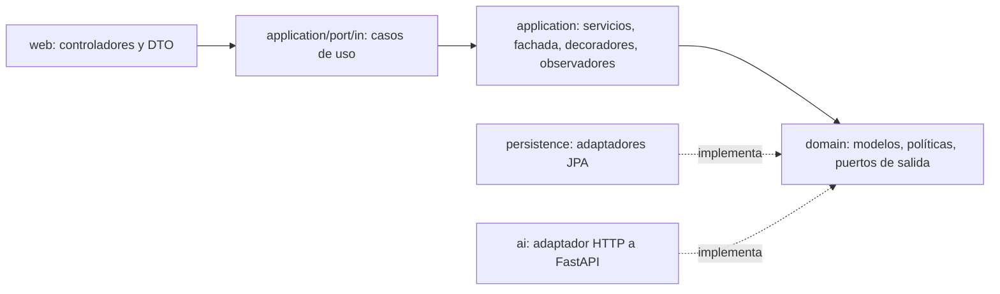

# CampusNexo Backend

API REST del campus universitario inteligente (proyecto de grado de Patrones de Software). Está hecha con Java 21, Spring Boot 4.1 y PostgreSQL. Recibe mediciones agregadas de los espacios, estima la ocupación con el servicio de IA (con respaldo local si la IA falla), genera recomendaciones auditables de climatización, ventilación e iluminación según el clima de cada sede, detecta alertas, gestiona reservas y muestra en vivo los puestos libres de la biblioteca.

## Qué problema del caso resuelve cada parte

| Problema del caso | Funcionalidad |
|---|---|
| Salones reservados pero vacíos o sobreocupados | Reservas con control de aforo y de solapamiento; alertas `RESERVA_SIN_USO` y `SOBRECUPO`. |
| Consumo de energía en espacios vacíos | Alerta `CONSUMO_ESPACIO_VACIO`, recomendaciones de HVAC e iluminación por sede y estimación en kWh y COP en el dashboard. |
| Biblioteca saturada sin información de puestos libres | `GET /api/v1/occupancy/live?type=BIBLIOTECA`: puestos libres, % de ocupación y estado `LIBRE`, `MODERADO` o `SATURADO`. |

## Arquitectura

El núcleo (`domain` y `application`) **no depende de Spring, JPA ni HTTP**; se puede compilar con `javac` sin dependencias. Los adaptadores de `infrastructure` implementan los puertos y `ApplicationConfiguration` es la raíz de composición.



```text
edu.campusnexo
├── domain/                     reglas puras, sin frameworks
│   ├── shared/                 DomainValidationException, DomainChecks, ResultLimit
│   ├── catalog/ telemetry/ occupancy/ alert/ reservation/
│   ├── climate/                decisiones, contexto, recomendación (Builder)
│   │   └── policy/             Abstract Factory + Strategy + Decorator térmico
│   └── port/                   puertos de salida (repositorios, OccupancyEstimator)
├── application/                casos de uso, uno por subpaquete
│   ├── port/in/                contratos de entrada, comandos y resultados
│   ├── exception/              errores de aplicación con código estable
│   ├── catalog/ telemetry/ occupancy/ climate/ alert/ reservation/ dashboard/
│   └── operations/             CampusOperationsFacade (Facade)
└── infrastructure/
    ├── config/                 composición de dependencias y reloj
    ├── web/                    controladores por recurso, DTO, errores, CORS, API key
    ├── persistence/            un subpaquete por agregado (entidades + adaptadores)
    ├── ai/                     HttpOccupancyEstimatorAdapter (Adapter)
    └── observability/          logs de observadores
```

Los patrones, sus participantes y el guion de demostración están en [`docs/patrones-de-software.md`](docs/patrones-de-software.md).

## Inicio local con Docker Compose

```sh
cp .env.example .env      # define contraseñas locales
docker compose up --build -d
curl http://localhost:8080/actuator/health
curl http://localhost:8080/api/v1/spaces
```

Si el servicio de IA no está levantado, la estimación de ocupación responde igual, con `source = RESPALDO_LOCAL` (se puede desactivar con `AI_FALLBACK_ENABLED=false`, y entonces responde `503`).

## Ejecución y pruebas con Maven

Requisitos: Java 21, Maven 3.9+ y Docker (para las pruebas de integración con Testcontainers).

```sh
mvn verify                # pruebas unitarias + integración con PostgreSQL 17 + cobertura JaCoCo
mvn spring-boot:run       # requiere un PostgreSQL local (ver DATABASE_URL)
```

El reporte de cobertura queda en `target/site/jacoco/index.html`, y la CI lo publica como artefacto `test-reports`.

| Suite | Qué demuestra |
|---|---|
| `domain/**` | Familias del Abstract Factory, estrategias, decorador de ciclo mínimo, Builder, validaciones. |
| `application/**` | Idempotencia y validación de la ingesta, Observer con fallos aislados, decoradores de IA, fachada de punta a punta, reservas, ocupación en vivo, energía. |
| `CampusNexoApiIntegrationTest` | Arranque real con Flyway V1–V9 y validación JPA, API key, alertas, evaluación con la IA caída, rutas antiguas, `ProblemDetail`. |

## API v1 (resumen)

| Método y ruta | Propósito |
|---|---|
| `GET /api/v1/spaces[?type=]`, `GET /api/v1/spaces/{id}` | Catálogo. |
| `POST /api/v1/telemetry` 🔑 | Registra una lectura (idempotente) y dispara los observadores. |
| `GET /api/v1/telemetry[?spaceId=&limit=]`, `GET /api/v1/spaces/{id}/telemetry` | Lecturas recientes. |
| `POST /api/v1/spaces/{id}/evaluations` | **Flujo completo**: última lectura → IA → recomendación. |
| `POST /api/v1/spaces/{id}/occupancy-estimates`, `GET …/occupancy-estimates` | Estimación de ocupación persistida. |
| `GET /api/v1/occupancy/live[?type=BIBLIOTECA]` | Ocupación y puestos libres en vivo. |
| `POST /api/v1/spaces/{id}/climate-recommendations`, `GET …` | Recomendación manual e historial. |
| `GET /api/v1/alerts[?spaceId=&type=&limit=]` | Alertas detectadas por los observadores. |
| `POST /api/v1/spaces/{id}/reservations` 🔑, `GET …/reservations` | Reservas. |
| `GET /api/v1/dashboard/summary` | Indicadores de las últimas 24 horas. |

🔑 = requiere la cabecera `X-API-Key` cuando `INGEST_API_KEY` está definida (obligatoria en producción). El detalle está en [`docs/api.md`](docs/api.md).

## Configuración

Todas las variables están documentadas en [`.env.example`](.env.example) y [`application.yml`](src/main/resources/application.yml). El perfil `prod` (`SPRING_PROFILES_ACTIVE=prod`) elimina las credenciales por defecto y exige `INGEST_API_KEY`.

## Despliegue

La guía para desplegar en Render con PostgreSQL administrado (incluye `render.yaml`) está en [`docs/despliegue.md`](docs/despliegue.md).

## Límites del prototipo

- Los umbrales, setpoints y la heurística de respaldo son valores ilustrativos y no están calibrados. No se deben presentar como ahorro ni precisión medidos.
- El backend no acciona HVAC, luces ni relés; el estado del HVAC se infiere de la última recomendación.
- La API key protege la ingesta, pero no identifica personas ni roles. Un uso institucional necesita autenticación de usuarios, TLS, retención de datos y evaluación de privacidad de la cámara.
- Las migraciones `V2` y `V5` siembran un catálogo de demostración (ya aplicadas; no se pueden editar sin romper las bases existentes). Los nombres son ilustrativos.
