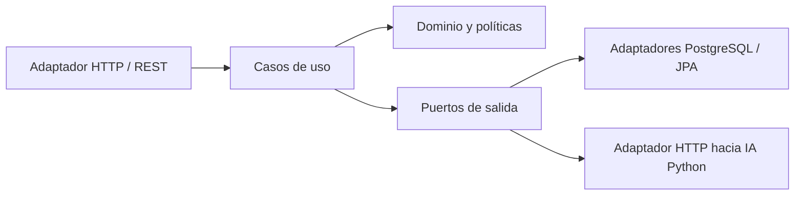

# CampusNexo Backend

API REST del campus universitario inteligente, implementada con Java 21, Spring Boot 4.1 y PostgreSQL. El backend recibe mediciones agregadas, mantiene el catálogo de sedes y espacios, solicita estimaciones de ocupación al servicio Python y genera recomendaciones ambientales auditables.

## Arquitectura

El núcleo de dominio y los casos de uso no dependen de Spring, JPA, HTTP ni del servicio Python. Los puertos describen lo que la aplicación necesita; los adaptadores de infraestructura implementan esas interfaces. La composición de dependencias se hace en `infrastructure/config/ApplicationConfiguration`.



Los paquetes siguen esta dirección:

```text
domain/           modelos, eventos, reglas e interfaces de puertos
application/      casos de uso y coordinación de reglas
infrastructure/   HTTP, JPA, configuración y adaptadores externos
```

La arquitectura hexagonal estructura las dependencias; no se cuenta como uno de los patrones GoF de la asignatura. La justificación de los patrones implementados está en [`docs/patrones-de-software.md`](docs/patrones-de-software.md).

## Inicio local con Docker Compose

Requisitos: Docker Engine o Docker Desktop con Compose.

```sh
cp .env.example .env
# Edita las contraseñas locales antes de arrancar.
docker compose up --build -d
docker compose logs -f backend
```

Verifica el backend:

```sh
curl http://localhost:8080/actuator/health
curl http://localhost:8080/api/v1/spaces
```

Compose inicia PostgreSQL y el backend. El servicio de IA se configura por medio de `AI_SERVICE_URL`; si no está levantado, telemetría y catálogo siguen disponibles, pero `POST /api/v1/occupancy/estimate` responde `503 Service Unavailable`.

Para detener los servicios conservando los datos, ejecuta `docker compose down`. Para borrar también el volumen local de PostgreSQL, ejecuta `docker compose down -v`.

## Ejecución desde Maven

Requisitos: Java 21, Maven 3.9+ y PostgreSQL 15+. Configura `DATABASE_URL`, `DATABASE_USER`, `DATABASE_PASSWORD` y, opcionalmente, `AI_SERVICE_URL`; luego:

```sh
mvn spring-boot:run
```

Flyway administra el esquema y carga un catálogo de demostración de dos sedes, edificios y espacios. Hibernate valida el esquema, pero no lo modifica (`ddl-auto: validate`).

## API v1

| Método y ruta | Propósito |
|---|---|
| `GET /api/v1/spaces` | Lista sedes, edificios y espacios registrados. |
| `POST /api/v1/telemetry` | Valida y persiste una lectura; publica el evento a observadores. |
| `GET /api/v1/telemetry?spaceId=AULA-301&limit=20` | Consulta las lecturas recientes; `limit` acepta de 1 a 100. |
| `GET /api/v1/dashboard/summary` | Resumen de espacios monitoreados y lecturas de las últimas 24 horas. |
| `POST /api/v1/occupancy/estimate?spaceId=AULA-301` | Solicita una estimación al servicio Python mediante el puerto `OccupancyEstimator`. |
| `POST /api/v1/climate/recommendations?spaceId=AULA-301` | Calcula y audita recomendaciones de HVAC, ventilación e iluminación. |
| `GET /actuator/health` | Estado de salud del backend. |

Ejemplo de telemetría (el timestamp es opcional y usa UTC si se omite):

```json
{
  "spaceId": "AULA-301",
  "peopleCount": 18,
  "objectCount": 0,
  "wifiDevices": 21,
  "co2Ppm": 820,
  "temperatureC": 23.1,
  "humidityPct": 58,
  "illuminanceLux": 410,
  "activePowerKw": 2.4
}
```

Ejemplo de recomendación climática:

```json
{
  "occupancy": 18,
  "co2Ppm": 820,
  "indoorTemperatureC": 27.1,
  "illuminanceLux": 380,
  "hvacOn": false,
  "minutesInCurrentHvacState": 12
}
```

El campo `outsideTemperatureC` es opcional; si falta, se usa la temperatura promedio de referencia de la sede. Cada recomendación devuelve su identificador, perfil climático, decisiones y explicaciones, y queda almacenada en `climate_recommendations`.

Los errores devuelven códigos HTTP coherentes: `400` para validación, `404` para espacios desconocidos y `503` si la IA no está disponible.

## Configuración

Las variables principales se documentan en [`.env.example`](.env.example). Spring también permite configurar directamente:

| Variable | Valor por defecto |
|---|---|
| `DATABASE_URL` | `jdbc:postgresql://localhost:5432/campusnexo` |
| `DATABASE_USER` / `DATABASE_PASSWORD` | `campusnexo` / `campusnexo` |
| `SERVER_PORT` | `8080` |
| `CORS_ALLOWED_ORIGIN` | `http://localhost:5173` |
| `AI_SERVICE_URL` | `http://localhost:8001` |

No guardes credenciales reales en Git. `.env` está excluido por `.gitignore`; usa secretos del gestor de despliegue para entornos compartidos.

## Privacidad y límites del prototipo

El contrato Java con IA transporta conteos agregados; no persiste imágenes, nombres ni identificadores de seguimiento. Las recomendaciones ambientales aplican umbrales de referencia, se guardan para auditoría y no accionan hardware. Antes de un uso real se requieren calibración con datos del campus, revisión de seguridad, autenticación/autorización, política de retención, TLS y validación de las reglas con responsables de infraestructura y bienestar.

El backend no integra directamente cámaras, sensores ni actuadores. La cámara está representada solo por el conteo agregado que puede enviar el servicio de IA.

## Compilación

La compilación automática de GitHub Actions usa Java 21 y ejecuta `mvn -DskipTests package`. En el equipo local puedes compilar con `mvn -DskipTests package`. La compilación confirma estructura y dependencias; los escenarios funcionales y pruebas automatizadas aún deben implementarse antes de una liberación.
