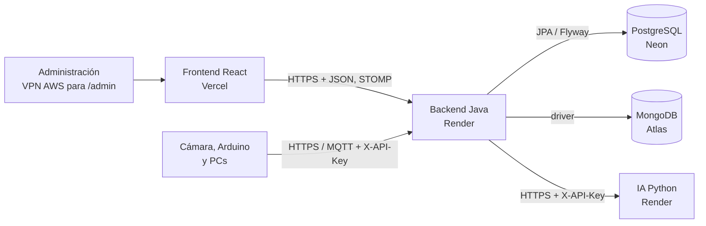

# CampusNexo · Backend

**CampusNexo** es el gemelo digital del campus Pasto de la Universidad Cooperativa de Colombia: bloques A y B, 107 espacios tomados del plano 2025-B más los salones piloto 301-A y 303-A. Es operativo, solo para la administración de la universidad. Este repositorio contiene la **lógica del sistema**, en Java 21 con Spring Boot 4.1:

- ocupación de cada salón, con el docente reconocido por zona;
- estados del salón y escenarios reconocidos;
- puestos de trabajo (CPU, silla y mesa) registrados por la cámara;
- docentes y estudiantes;
- clima predictivo, reservas con check-in, alertas;
- seguridad por rol y por red.

| Repositorio | Papel |
|---|---|
| `campusnexo-backend` (este) | Reglas, coordinación, seguridad y bases de datos. Único que habla con las BD y con la IA. |
| `campusnexo-frontend` | Tablero web en Vercel; solo habla con este backend. |
| `campusnexo-ai-service` | ML en Python (ocupación, anomalías, pronóstico, asignación) y visión de borde. |

## Arquitectura en 4 capas



El dominio y la aplicación **no dependen de Spring, JPA ni HTTP**, y ArchUnit lo verifica. Los adaptadores de `infrastructure` implementan los puertos; `ApplicationConfiguration`, `HexagonalBeanConfiguration`, `AdministracionConfiguration` e `HistoryConfiguration` son las raíces de composición.

```text
edu.campusnexo
├── domain/          reglas puras: catálogo, telemetría, visión, ocupación, clima (+policy), gemelo (+hvac),
│                    reservas, alertas, persona (Docente/Estudiante), activo (CPU/Silla/Mesa, PuestoDeTrabajo,
│                    propuesta y emparejamiento), escenario (12 detectores) y puertos de salida
├── application/     casos de uso: telemetría y observadores, ocupación resiliente, clima, gemelo, reservas y
│                    check-in, panel, fachada, personas, inventario, registro de puestos, herramientas de IA
└── infrastructure/  REST, MQTT, STOMP, JPA, MongoDB, HTTP a la IA, seguridad (token, roles, red de administración)
```

- [`docs/analisis-del-dominio.md`](docs/analisis-del-dominio.md): problema, propuesta, clases, clases abstractas, interfaces y polimorfismo, con diagramas de clases, E-R y secuencia.
- [`docs/patrones-de-software.md`](docs/patrones-de-software.md): los patrones y su papel en la comunicación.
- [`docs/gemelo-digital.md`](docs/gemelo-digital.md): el gemelo.
- [`docs/api.md`](docs/api.md): la API.
- [`docs/despliegue.md`](docs/despliegue.md): el despliegue.
- [`docs/adr/`](docs/adr/README.md): las decisiones.

## Inicio local

```sh
cp .env.example .env                       # contraseñas locales, un ADMIN (tools/auth/hash_password.py) y claves de sensor
docker compose up --build -d               # PostgreSQL, MongoDB, Mosquitto y backend
docker compose --profile sistema up -d     # además el servicio de IA (repo hermano ../campusnexo-ai-service)
python tools/e2e/e2e_admin.py              # pruebas de sistema como ADMIN (credenciales por variables de entorno)
```

## Pruebas

Se necesitan Java 21, Maven 3.9+ y Docker (Testcontainers con PostgreSQL 17 y MongoDB 8).

```sh
mvn verify
```

| Suite | Qué demuestra |
|---|---|
| `domain/**` | Familias climáticas, estrategias, decoradores, Builder, Kalman, MPC, cadena HVAC, rol por zona, polimorfismo de personas, Composite de puestos, propuesta y emparejamiento, detectores de escenario. |
| `application/**` | Ingesta idempotente, observadores, IA resiliente, fachada, reservas con titular y check-in, inventario y latidos, registro de puestos, herramientas de IA, publicador tolerante a fallos. |
| `HexagonalArchitectureTest` | El núcleo no depende de frameworks; los escenarios solo leen el gemelo. |
| `MongoTwinHistoryAdapterTest` | El historial contra un MongoDB real; si MongoDB cae, el gemelo sigue. |
| `CampusNexoApiIntegrationTest` | Arranque real con Flyway V1–V11. Cubre: registro automático de 301-A, profesor adelante y estudiantes al fondo, administración solo por red y rol, check-in en kiosco, CPU sin usuario, reservas concurrentes, STOMP con sesión. |

## Límites conocidos

- Umbrales, setpoints, potencias y qué salones tienen clima son valores ilustrativos, por confirmar con el campus. Las medidas de 301-A y 303-A son ilustrativas hasta medirlos.
- Los datos que no vienen de un dispositivo real llegan con `emulated: true` y el tablero los muestra como tales.
- El limitador de peticiones, el broker STOMP y la bandeja MQTT viven en memoria: una sola instancia. Escalar requiere un relay STOMP externo y un limitador compartido.
