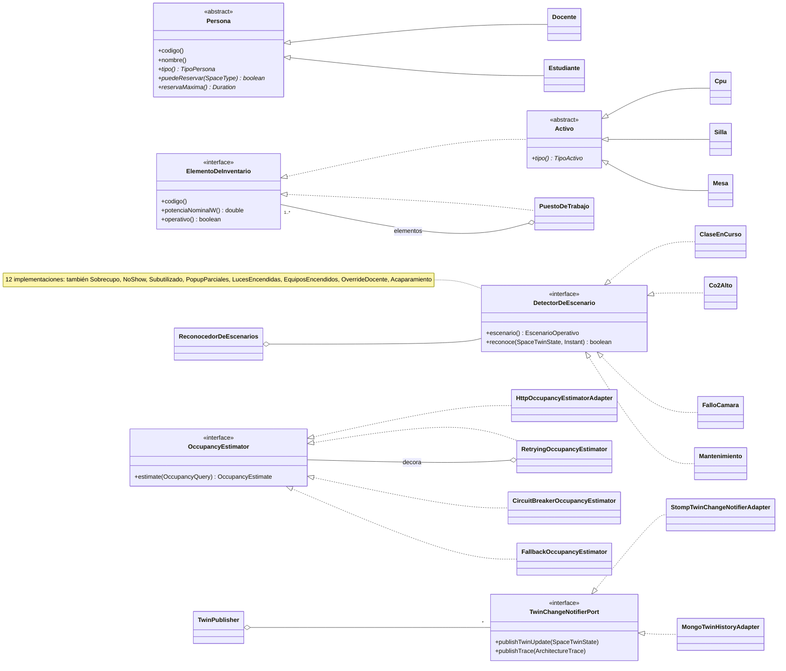
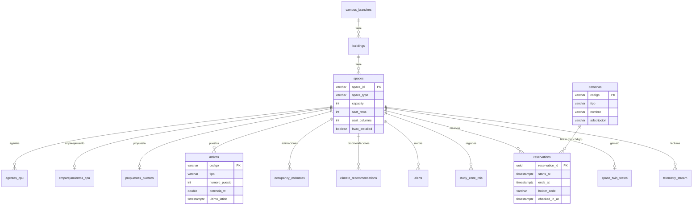
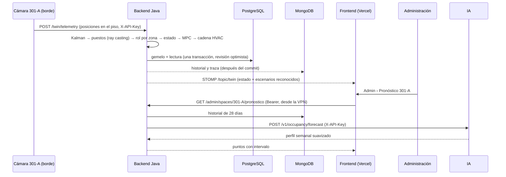

# Análisis del dominio

## 1. Problema

El campus Pasto de la Universidad Cooperativa de Colombia tiene 107 espacios en dos bloques. La administración no sabe, salvo recorriendo los pisos:

- qué salones reservados quedan vacíos (*no-show*) y cuáles se llenan por encima del aforo;
- dónde quedan luces y computadores encendidos sin nadie, en especial en las salas de cómputo después de clase;
- si hay clase de verdad: un docente frente a estudiantes, no solo personas en el salón;
- qué puestos (CPU, silla y mesa) existen en cada sala y cuáles faltan o fallan;
- qué sensores reportan valores imposibles, cómo se ocupará un salón y qué salón conviene a cada curso;
- cómo evitar que el clima caliente salones vacíos, en una ciudad de unos 13,5 °C.

## 2. Propuesta

Un **gemelo digital operativo**: cada salón tiene un estado que se recalcula con lo que reportan sus dispositivos:
- la cámara del borde (personas, sin imágenes);
- el Arduino (temperatura, luz, corriente);
- el agente de cada PC (latido);
- el kiosco de la puerta (check-in del titular).

Las reglas del sistema viven en Java (backend hexagonal) y el aprendizaje automático en Python (servicio de IA y borde). La administración ve el campus en vivo, recibe alertas, registra personas y puestos, y pide a la IA asignaciones, anomalías y pronósticos. Sus rutas solo responden con rol ADMIN y desde la VPN de la universidad.

**Privacidad por diseño (Ley 1581 de 2012):**
- la cámara procesa en el salón y solo envía posiciones;
- docentes y estudiantes se identifican por su código en el kiosco, nunca por biometría;
- el rol en el salón (docente o estudiante) se deduce de **dónde** está cada persona, no de **quién** es.

## 3. Actores

| Actor | Qué hace | Rol en el sistema |
|---|---|---|
| Administración de la universidad | Registra personas y puestos, confirma el registro automático, usa las herramientas de IA | `ADMIN`, solo desde la VPN |
| Personal de operación | Reservas, controles manuales, mantenimiento | `OPERATOR` |
| Jurado o stakeholder | Observa el campus en vivo | `VIEWER` |
| Docente / Estudiante | Titular de una reserva; confirma su llegada con su código | Entidad del dominio, sin cuenta |
| Cámara, Arduino, agente de PC, kiosco | Reportan al gemelo | `SENSOR` (clave por dispositivo) |

## 4. Clases y objetos principales

| Concepto | Clase | Tipo |
|---|---|---|
| Espacio del campus | `CampusSpace`, `SeatLayout`, `RoomCode` | `record` (objetos de valor inmutables) |
| Estado del salón | `SpaceTwinState` (con `Builder`), `SpaceStatus`, `RoomCondition`, `HvacControlState` | `record` + `enum` |
| Personas en el salón por rol | `Presence` | `record` |
| Docente y estudiante | `Persona` → `Docente`, `Estudiante` | clase abstracta sellada + subclases |
| Puesto de trabajo | `ElementoDeInventario`, `Activo` → `Cpu`, `Silla`, `Mesa`, `PuestoDeTrabajo` | interfaz sellada + clase abstracta + Composite |
| Registro por cámara | `PropuestaDePuestos`, `PuestoPropuesto`, `EmparejamientoCpu` | `record` |
| Escenarios | `EscenarioOperativo`, `DetectorDeEscenario` (12 implementaciones), `ReconocedorDeEscenarios` | `enum` + interfaz + Strategy |
| Ocupación | `OccupancyKalmanDomainService`, `OccupancyBelief`, `OccupancyEstimator` (Decorator) | servicio + `record` + interfaz |
| Clima | `ClimatePolicyFactory` (Abstract Factory), `ThermalPolicy`, `HvacSettingRule` (Chain of Responsibility) | interfaces |
| Reserva | `Reservation` (titular y check-in) | `record` |

Ejemplo de objetos en la piloto:
- `new Docente("D-100", "Marta Ruiz", "Ingeniería de Software")`.
- `new PuestoDeTrabajo("301-A", 7, List.of(new Mesa("301A-MESA-07", false), new Silla("301A-SILLA-07", false), new Cpu("PC-301A-07", 120, false, latido)))`, cuyo código es `301-A-P07`, la misma región que ve la cámara.

## 5. Clases abstractas, interfaces y polimorfismo

**Dónde el polimorfismo reemplaza un `switch`:**

- **Reglas de reserva.** `ReservationService` le pregunta al titular `persona.puedeReservar(tipo)` y `persona.reservaMaxima()`. Un docente reserva aulas y salas de cómputo hasta 4 h; un estudiante, salas de estudio y biblioteca hasta 2 h. Un nuevo tipo de persona no toca el servicio.
- **Inventario (Composite).** `potenciaNominalW()` y `operativo()` se piden igual a un activo suelto o a un puesto completo; el puesto suma o exige a sus partes.
- **Escenarios (Strategy).** El reconocedor recorre 12 detectores sin saber qué mira cada uno. Agregar un escenario es agregar una clase.
- **Resiliencia (Decorator y State).** La IA real, el reintento, el circuito y el respaldo comparten `OccupancyEstimator`. El circuito cambia de comportamiento con su estado interno (`Closed`, `Open`, `HalfOpen`).
- **Seguidores del gemelo (Observer).** El tablero (STOMP) y el historial (MongoDB) reciben cada cambio por el mismo puerto. Si uno falla, el otro sigue.

## 6. Modelo de datos

**PostgreSQL** (relacional, transaccional, en Neon):

**MongoDB** (no relacional, en Atlas). Son colecciones de solo inserción que crecen sin frenar el pipeline:

| Colección | Documento | Uso |
|---|---|---|
| `historial_gemelo` | Un cambio del gemelo: personas, estimación, σ, docentes, estudiantes, conteo de cámara, CO₂, escenarios, `emulated` | Pronóstico de ocupación, CSV de evaluación de la IA |
| `trazas` | La traza hexagonal de cada decisión (caduca a los 30 días) | Auditoría y vista "Cómo funciona" |

El estado del gemelo y la telemetría siguen en PostgreSQL, en una sola transacción. MongoDB recibe la copia después del commit, como mejor esfuerzo.

## 7. Recorrido de una petición (4 capas)

## 8. Atributos de calidad de la piloto

| ID | Atributo | Escenario | Medida |
|---|---|---|---|
| QA-1 | Exactitud | Profesor de pie frente al tablero, estudiantes al fondo, con ruido de detector | MAE de conteo ≤ 1; docente identificado ≥ 95 % (medido contra `verdad.csv` del emulador) |
| QA-2 | Desempeño | Frame del borde hasta el tablero | Inferencia ≤ 250 ms; p95 de extremo a extremo ≤ 2 s |
| QA-3 | Escalabilidad | 107 salones a 1 Hz | p95 de ingesta < 300 ms en local; error < 1 % (`carga/prueba_carga.py`) |
| QA-4 | Privacidad | Operación normal | 0 imágenes fuera del borde; datasets solo con consentimiento |
| QA-5 | Disponibilidad | IA o MongoDB caídos | El circuito usa el respaldo local; el gemelo sigue sin historial |

## 9. Mejoras de diseño incorporadas

1. **Una sola fuente de reglas.** Las copias en TypeScript (simulación del navegador) y en Python (térmico, mesas) se eliminaron; las reglas viven en Java y la IA solo hace aprendizaje automático.
2. **Escenarios reconocidos, no simulados.** Se deducen del estado real con detectores; el backend no contiene código de simulación.
3. **Personas y puestos como entidades.** Antes eran texto libre y conteos; ahora tienen reglas propias (polimorfismo) y un inventario que la cámara audita.
4. **Registro automático de puestos.** La cámara propone y el administrador confirma, lo que evita dar de alta 30 puestos a mano.
5. **NoSQL donde aporta.** El historial y las trazas crecen sin límite fijo y no necesitan transacciones.
6. **Seguridad en capas.** Rol, red de administración (VPN con IP fija), IP real tomada del proxy de confianza y claves por dispositivo.
7. **Calidad mecanizada.** CI en todo push, ArchUnit, Testcontainers, casos dorados compartidos entre Java y Python, y compuerta de atributos de calidad para la IA.
